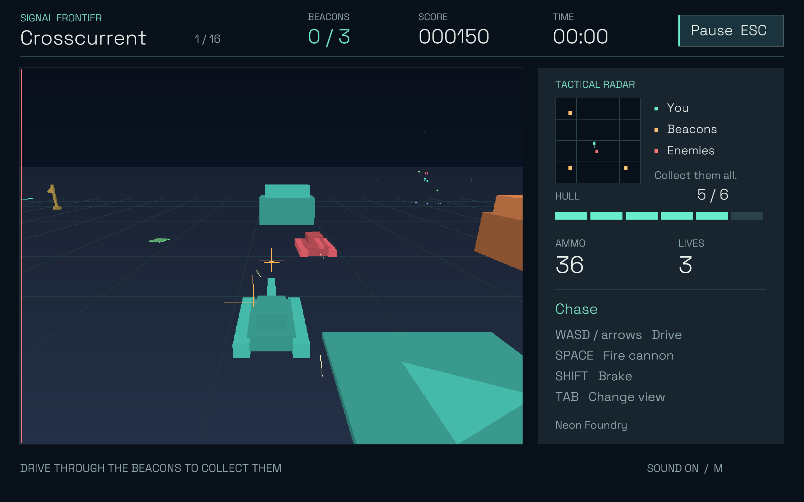
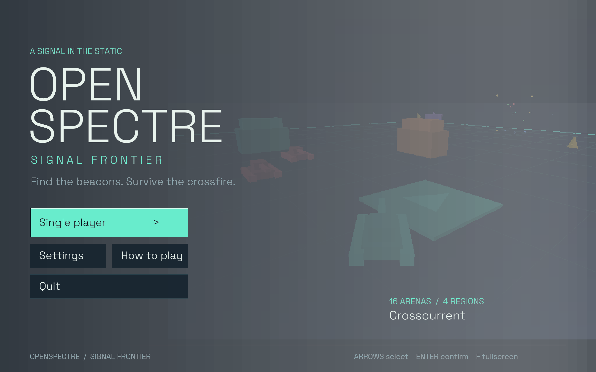
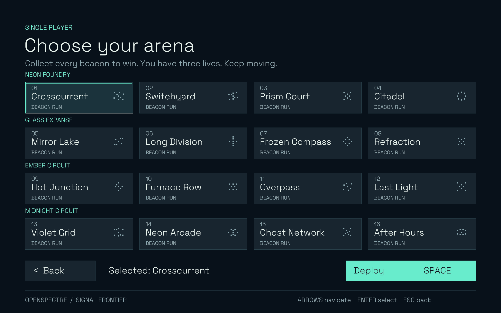
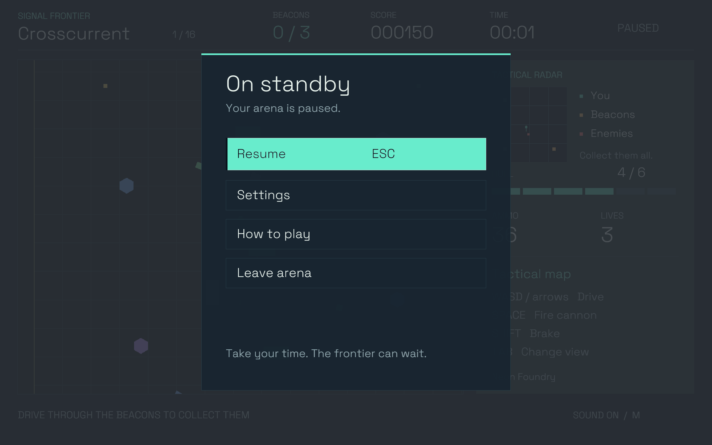
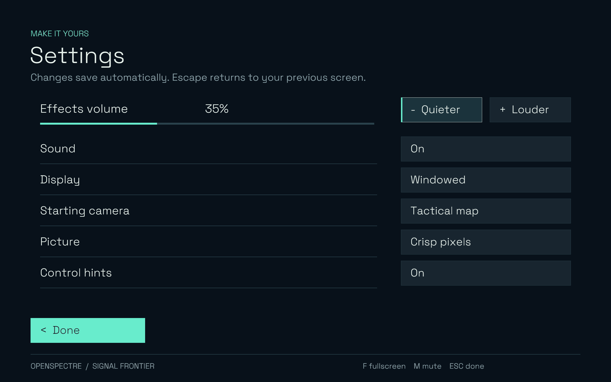
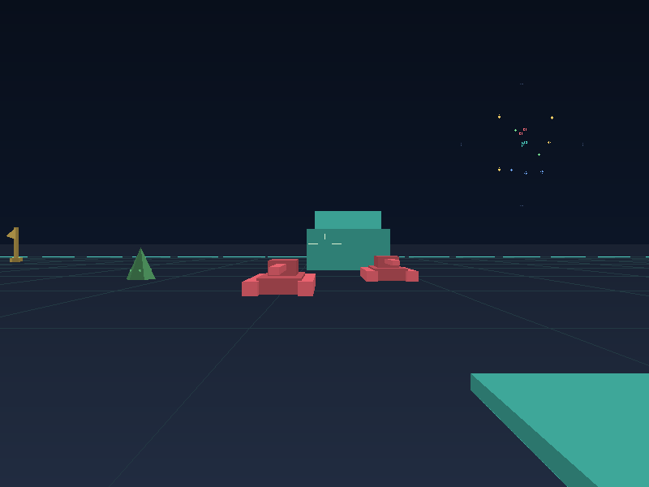
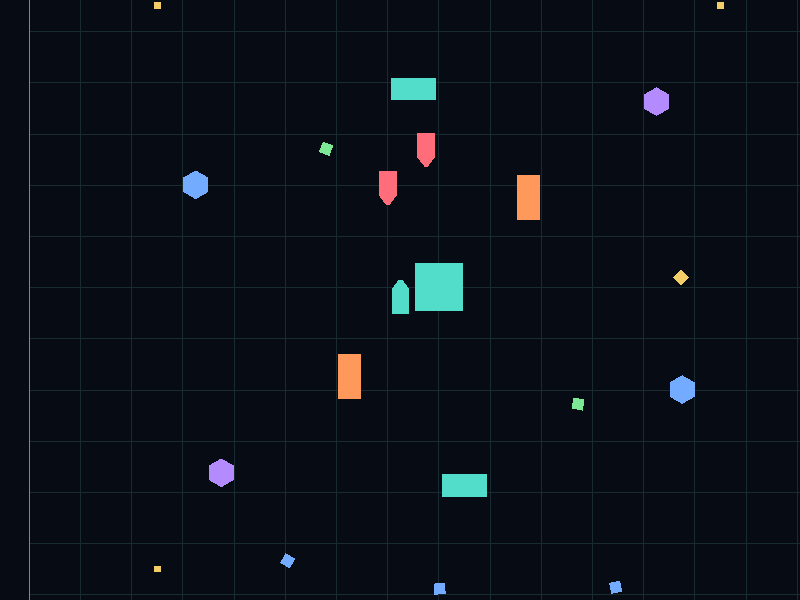

# OpenSpectre

A Rust reconstruction of **Spectre VR**, the classic Macintosh tank game, with a native desktop client and a browser playground through WebAssembly.
The desktop client offers single-player combat. The browser playground also supports two-player multiplayer.
Both share the same simulation and renderer in `spectre-core`. The project is still in development.

The bundled **Signal Frontier** pack includes 16 new arenas, models, and sounds. No original disc is needed.
The browser playground and development tools can also [load assets from your own classic disc](docs/asset-packs.md).



*Actual native client capture on macOS, including the game HUD.*

## Desktop client

**[Download OpenSpectre 0.1.0](https://github.com/dustywusty/openspectre/releases/tag/v0.1.0)**

| Computer | Download |
| --- | --- |
| Mac with Apple silicon | [macOS ARM64](https://github.com/dustywusty/openspectre/releases/download/v0.1.0/OpenSpectre-0.1.0-macos-arm64.zip) |
| Mac with Intel | [macOS x86-64](https://github.com/dustywusty/openspectre/releases/download/v0.1.0/OpenSpectre-0.1.0-macos-x86_64.zip) |
| Windows with Intel or AMD | [Windows x86-64](https://github.com/dustywusty/openspectre/releases/download/v0.1.0/OpenSpectre-0.1.0-windows-x86_64.zip) |
| Windows on ARM | [Windows ARM64](https://github.com/dustywusty/openspectre/releases/download/v0.1.0/OpenSpectre-0.1.0-windows-arm64.zip) |
| Linux with Intel or AMD | [Linux x86-64](https://github.com/dustywusty/openspectre/releases/download/v0.1.0/OpenSpectre-0.1.0-linux-x86_64.tar.gz) |
| Linux on ARM64 | [Linux ARM64](https://github.com/dustywusty/openspectre/releases/download/v0.1.0/OpenSpectre-0.1.0-linux-arm64.tar.gz) |

Extract the archive, then open the app. The macOS app is not notarized; Windows packages do not have an Authenticode signature.
See the release notes for first-launch instructions and platform requirements.

Launch the app, choose **Single player**, select an arena, and choose **Deploy**.
Collect every beacon to complete the arena, then replay or choose another arena from the results screen.

- Play 16 arenas with native sound, three camera views, a tactical radar, and a readable HUD.
- Pause with Escape. The game also pauses when its window loses focus.
- Adjust volume, fullscreen, starting camera, picture filtering, and control hints.
- Keep your settings, best scores, fastest completions, and wins between sessions.

The app includes the Signal Frontier assets and runs without a server, browser, or original disc.
Desktop multiplayer rooms and controller support are planned.

| Title screen | Choose an arena |
| --- | --- |
|  |  |

| Pause | Settings |
| --- | --- |
|  |  |

*Screenshots from the packaged macOS client.*

### Run from source

Requires **Rust 1.88+** and your platform's compiler tools.
On Debian or Ubuntu, install `libasound2-dev` first.

```sh
git clone https://github.com/dustywusty/openspectre.git
cd openspectre
cargo run --locked --release -p spectre-client
```

| Drive | Shoot | Change view | Pause | Fullscreen | Mute |
| --- | --- | --- | --- | --- | --- |
| WASD / arrows | Space | Tab | Escape | F / F11 | M |

See [desktop controls, saved data, and platform requirements](docs/desktop-client.md).

### Desktop releases

The release workflow builds six native packages:

| Operating system | Architectures | Package |
| --- | --- | --- |
| macOS | Apple silicon (ARM64), Intel (x86-64) | `.app` in ZIP |
| Windows | ARM64, x86-64 | EXE in ZIP |
| Linux | ARM64, x86-64 | TAR.GZ |

Push a matching version tag, such as `v0.1.0`, to build and test all six packages.
After every build passes, the workflow publishes the packages and SHA-256 checksums to GitHub Releases.
Publishing a GitHub Release also starts the builds. Branch and pull-request runs produce Actions artifacts.
See the [release process](docs/desktop-releases.md) for versioning, platform requirements, signing status, and manual builds.

To create a package for your current platform, install **Python 3** and run:

```sh
python3 scripts/package-desktop.py
```

Packages appear in `artifacts/desktop/` with the game assets and license notices included.

## Browser playground

Use the playground for quick access, multiplayer rooms, experiments, and debugging.
Requires **Rust 1.88+**, **Node.js 22+**, and **Python 3**.

```sh
git clone https://github.com/dustywusty/openspectre.git
cd openspectre
rustup target add wasm32-unknown-unknown
npm ci
npm run build
npm start
```

Open **http://localhost:5174/#drive**. Click **Play** to play.

| Drive | Shoot | Change view | Fullscreen |
| --- | --- | --- | --- |
| WASD / arrows | Space | Tab | F |

For multiplayer, create a room and share its invitation link. See [setup for friends on other computers](docs/multiplayer.md).

| Cockpit | Overhead |
| --- | --- |
|  |  |

*Browser game captures. Browser HUD overlays are not shown.*

[Classic disc setup](docs/asset-packs.md) · [Development tools](docs/development-history.md#native-desktop-viewer) · [Recovery notes](docs/disassembly.md) · [Tests and recordings](docs/build-evidence.md)

[Changelog](CHANGELOG.md)
