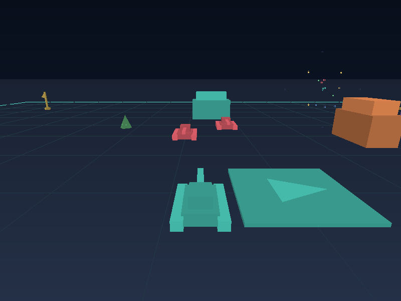

# OpenSpectre

A native Rust reconstruction of **Spectre VR**, the classic Macintosh tank game, playable in your browser through WebAssembly.
Still in development, with single-player combat and two-player multiplayer.

The bundled **Signal Frontier** pack includes 16 new arenas, models, and sounds. No original disc is needed.
You can also [load assets from your own classic disc](docs/asset-packs.md).



| Cockpit | Overhead |
| --- | --- |
|  |  |

*Actual game captures. Browser HUD overlays are not shown.*

## Run it

Requires **Rust 1.88+**, **Node.js 22+**, and **Python 3**.

```sh
git clone https://github.com/dustywusty/openspectre.git
cd openspectre
rustup target add wasm32-unknown-unknown
npm ci
npm run build
npm start
```

Open **http://localhost:5174/#drive**. Click **Play** to play.

| Drive | Shoot | Change view | Fullscreen |
| --- | --- | --- | --- |
| WASD / arrows | Space | Tab | F |

For multiplayer, create a room and share its invitation link. See [setup for friends on other computers](docs/multiplayer.md).

[Classic disc setup](docs/asset-packs.md) · [Native desktop and tools](docs/development-history.md#native-desktop-viewer) · [Recovery notes](docs/disassembly.md) · [Tests and recordings](docs/build-evidence.md)

[Changelog](CHANGELOG.md)
